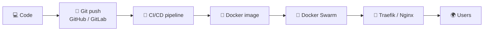
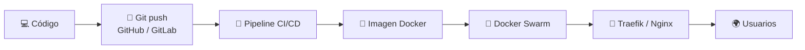

[**🇬🇧 English**](#en) &nbsp;·&nbsp; [**🇲🇽 Español**](#es)

# 👋 Hi, I'm Andy

> [!TIP]
> **Open to work:** freelance projects and my first role in the private sector. 📫 [andresag253@gmail.com](mailto:andresag253@gmail.com?subject=Hello%20Andy)

**Systems Engineer** · <!--AGE-->23<!--/AGE--> years old · based in Mexico 🇲🇽

I build and ship web stuff end to end: from the code, to the container, to the server it runs on.
I have **2 years of experience as a DevOps / backend engineer at a government agency**, keeping real
services up and running.

## 🛠️ Tech stack

| | |
|---|---|
| 🧠 **Backend** | Go, PHP, microservices, WebSocket, MongoDB |
| 🔌 **Integrations** | SOAP web services, XML |
| 🐳 **Infrastructure** | Docker, Docker Swarm, Traefik, Nginx, Linux servers |
| 🔁 **Delivery** | CI/CD with GitHub and GitLab |
| 🌐 **Frontend** | JavaScript |

## ⚙️ How I ship

## 🚀 Featured

<table>
<tr>
<td width="50%" valign="top">

### 🎮 [Odi Sort](https://github.com/AndyDevX/bubble-sort)
A color-sorting puzzle game for mobile, built with **TypeScript**. Auto-deployed to GitHub Pages on
every push and packaged for Android.

[▶️ Play it](https://andydevx.github.io/bubble-sort/) · [📂 Source](https://github.com/AndyDevX/bubble-sort)

</td>
<td width="50%" valign="top">

### 🌐 Portfolio
Currently in the works. A place to show projects and case studies.

*Coming soon…*

</td>
</tr>
</table>

## 📫 Let's talk

Got a project, or a team that needs someone who can ship it **and** keep it running?

 

---

# 👋 Hola, soy Andy

> [!TIP]
> **Disponible:** proyectos freelance y mi primer empleo en el sector privado. 📫 [andresag253@gmail.com](mailto:andresag253@gmail.com?subject=Hola%20Andy)

**Ingeniero en Sistemas Computacionales** · <!--AGE_ES-->23<!--/AGE_ES--> años · desde México 🇲🇽

Construyo y publico cosas para la web de principio a fin: del código, al contenedor, al servidor
donde corre. Tengo **2 años de experiencia como ingeniero DevOps / backend en una dependencia de
gobierno**, manteniendo servicios reales en funcionamiento.

## 🛠️ Stack tecnológico

| | |
|---|---|
| 🧠 **Backend** | Go, PHP, microservicios, WebSocket, MongoDB |
| 🔌 **Integraciones** | Servicios web SOAP, XML |
| 🐳 **Infraestructura** | Docker, Docker Swarm, Traefik, Nginx, servidores Linux |
| 🔁 **Entrega** | CI/CD con GitHub y GitLab |
| 🌐 **Frontend** | JavaScript |

## ⚙️ Cómo publico

## 🚀 Destacado

<table>
<tr>
<td width="50%" valign="top">

### 🎮 [Odi Sort](https://github.com/AndyDevX/bubble-sort)
Juego de ordenar colores para móvil hecho con **TypeScript**. Se despliega solo a GitHub Pages en
cada push y está empaquetado para Android.

[▶️ Juégalo](https://andydevx.github.io/bubble-sort/) · [📂 Código](https://github.com/AndyDevX/bubble-sort)

</td>
<td width="50%" valign="top">

### 🌐 Portafolio
En construcción. Un lugar para mostrar proyectos y casos de estudio.

*Próximamente…*

</td>
</tr>
</table>

## 📫 Hablemos

¿Tienes un proyecto, o un equipo que necesita a alguien que lo saque adelante **y** lo mantenga
funcionando?

